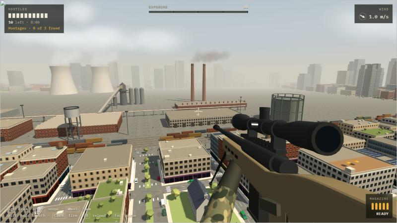
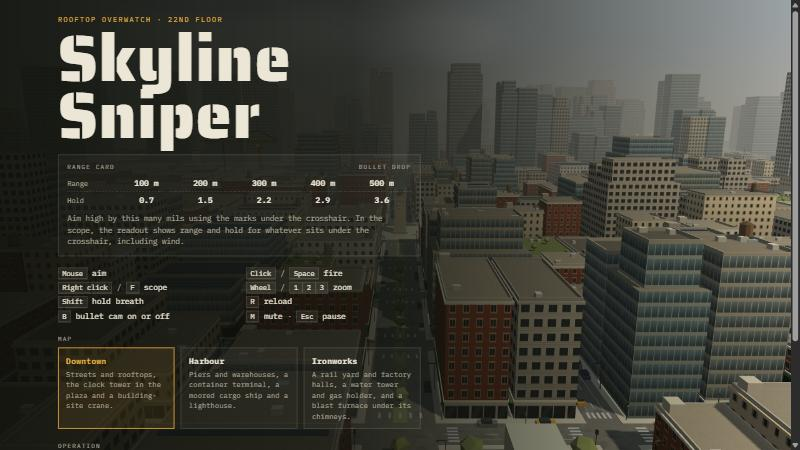

# Skyline Sniper

A low-poly 3D sniper game that runs in the browser. From a rooftop on the 22nd floor, you free three hostages held at gunpoint on rooftops around the city, one at a time. The only armed people are their captors.



## Running it

The game is a single page, `index.html`. It loads the village kit models from `models/` with `fetch`, so serve the folder rather than opening the file directly:

```bash
python -m http.server 8000
```

Then open <http://localhost:8000>. If the page is opened straight from disk, the game still runs, but simple shapes stand in for the kit models.

It needs an internet connection the first time, for Three.js r128 and the fonts, which load from public CDNs.

## How a mission plays

- **One hostage at a time.** A short cinematic shows each captor holding a hostage on their roof, then flies back across the city to you. Free that hostage, and the next scene plays. They're revealed nearest first.
- **The shot.** Each captor keeps the hostage between himself and your tower, so only his head shows above theirs. If you hit a hostage, the mission is over.
- **Screams.** Once you've been shown a hostage, they scream every few seconds: close and loud in their scene, fainter and a moment late from your roof. They scream more often once their captor starts counting, and again when a round lands near them or their captor drops.
- **The clock.** If a round lands near a captor or your exposure passes 75%, that captor gives you 15 seconds.
- **Exposure.** Every shot raises it, and so does a captor who knows you're out there. At 100% you're compromised.
- **Ballistics.** Rounds travel at 820 m/s with real drop and wind drift. The range card on the menu gives the hold in mils, and the scope readout shows range and hold for whatever is under the crosshair.

## Maps

- **Downtown.** Streets and rooftops, a clock tower in the plaza and a building-site crane.
- **Harbour.** Brick warehouses on the west pier, a container terminal with two ship-to-shore cranes, a moored cargo ship, a breakwater with a lighthouse, and a marina.
- **Ironworks.** A fenced steelworks with a rail yard, a brick rolling mill, a concrete machine shop, a water tower and a gas holder, a blast furnace with its stoves and conveyor, two smoking chimneys, and cooling towers in the haze.



Pick a map on the menu. The city is generated when the page loads, so switching maps reloads the page. Each map keeps its own best scores.

## Operations

| Operation | Conditions |
| --- | --- |
| Morning haze | Light wind, soft haze past 400 m |
| Dusk | Gusty wind, long shadows, lights coming on |
| Fog bank | Calm air, thick fog, far targets fade out |

## Controls

| Input | Action |
| --- | --- |
| Mouse | Aim |
| Click / Space | Fire |
| Right click / F | Scope |
| Wheel / 1 2 3 | Zoom (4×, 8×, 16×) |
| Shift | Hold breath |
| R | Reload |
| B | Bullet cam on or off |
| M | Mute |
| Esc / P | Pause |

The game locks the mouse while you aim, so the cursor stays inside the window. If the browser won't lock it, hold the cursor against an edge of the screen to keep turning that way. Touch screens get on-screen buttons.

## Credits

- Cars, vans, the school bus, street lamps, benches, phone and post boxes, wheelie bins, satellite dishes, shrubs, the church, the pub and the shop come from the author's own Gaeltacht Village Kit (`models/`, base64-encoded GLB files).
- Rendering uses [Three.js](https://threejs.org/) r128, with its GLTFLoader and the meshopt decoder.
- Fonts are IBM Plex Mono and Saira Stencil One, from Google Fonts.
